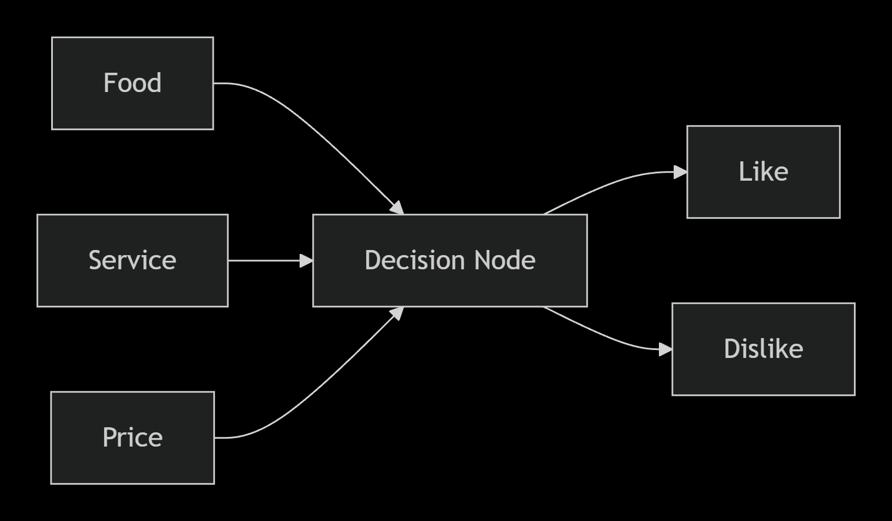

# CEP146 Lab 8 - How a Neural Network Learns

## Team Members
Name: Sheharyar Humayun
Name: Mohamed Ali

## Objective
Simulate how a neural network learns from mistakes by adjusting weights and improving predictions.

## Neural Network
Inputs: Food, Service, Price
Decision Node: Predicts LIKE or DISLIKE
Output: LIKE / DISLIKE

## Team Roles
**Person 1 - Input Feeder / Tracker**
Reads each scenario. Reveals the correct answer. Records predictions and weight changes.

**Person 2 - Decision Node**
Predicts LIKE or DISLIKE. Helps adjust the weights after mistakes.

---

## Part A - Training Phase

### Initial Weights
| Feature | Weight |
| :--- | :--- |
| Food | 1 |
| Service | 1 |
| Price | 1 |

### Training Results
| Card | Prediction | Actual Answer | Correct? | Weight Change |
| :--- | :--- | :--- | :--- | :--- |
| 1 | LIKE | LIKE | Yes | No change |
| 2 | LIKE | DISLIKE | No | Food +1, Price +1 |
| 3 | LIKE | LIKE | Yes | No change |
| 4 | DISLIKE | DISLIKE | Yes | No change |
| 5 | LIKE | LIKE | Yes | No change |
| 6 | DISLIKE | DISLIKE | Yes | No change |
| 7 | LIKE | LIKE | Yes | No change |
| 8 | DISLIKE | DISLIKE | Yes | No change |
| 9 | LIKE | LIKE | Yes | No change |
| 10 | DISLIKE | DISLIKE | Yes | No change |

### Weight Progression
Starting weights: Food = 1, Service = 1, Price = 1

After Card 2: Food = 2, Service = 1, Price = 2
The prediction was incorrect because good service was given too much influence. The bad food and expensive price were stronger indicators of DISLIKE, so Food and Price received more weight.

After Card 5: Food = 3, Service = 1, Price = 2
The prediction was incorrect because the expensive price caused a DISLIKE prediction, but the excellent food and service resulted in LIKE. This showed that food quality should have more influence.

### Final Weights
Food 3
Service 1
Price 2

Food became the most important feature, followed by Price. Service had the least influence on the final decision.

### Training Accuracy
Correct predictions: 8 out of 10
Accuracy: 80%

The predictions became more accurate after the weights were adjusted.

---

## Part B - Testing Phase
Use the learned weights from Part A without changing them.

| Card | Prediction | Actual Answer | Correct? |
| :--- | :--- | :--- | :--- |
| 11 | LIKE | LIKE | Yes |
| 12 | DISLIKE | DISLIKE | Yes |
| 13 | LIKE | LIKE | Yes |

### Testing Accuracy
Correct predictions: 3 out of 3
Accuracy: 100%

### Team Comparison
Which feature became the most important? Food.
Which feature became the least important? Service.
Did prediction accuracy improve over time? Yes. After adjusting the weights, later predictions became more accurate. 
Training result: 8 out of 10 correct. Testing result: 3 out of 3 correct.

---

## Reflection

### 1. How did your predictions improve?
Our predictions improved because we adjusted the weights after incorrect predictions. At first, all three inputs had equal importance. After making mistakes, we learned that Food had the strongest influence and Price was also important. This made later predictions more accurate.

### 2. How did weights help you learn?
Weights showed how important each input was in the decision. A higher weight meant that the feature had more influence on the final prediction. By changing the weights after mistakes, the decision process gradually became better.

### 3. What would happen with more layers or inputs?
With more layers or inputs, the network could consider more information and recognize more complex patterns. However, it would also become more complicated and would require more examples and training.

### 4. How does this reflect how real AI works?
This activity is a simplified version of how real neural networks learn. Real neural networks make predictions, compare them with correct outcomes, and adjust numerical weights to reduce future errors. Real AI systems use many more inputs, nodes, layers, and mathematical calculations, but the basic learning idea is similar.
